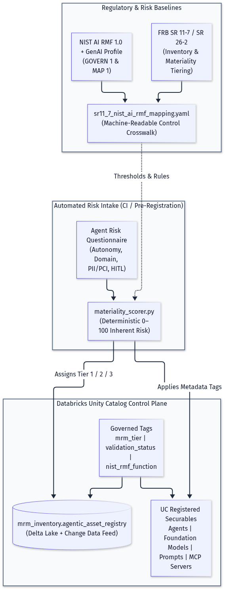

# Governing Agentic AI in Banking: Mapping SR 11-7 & NIST AI RMF onto Databricks Unity Catalog

## Part 1 of 4: Building an Open-Source Reference Architecture for Auditable Enterprise AI Agents

For over a decade, banking Model Risk Management (MRM) has rested on Federal Reserve **SR 11-7**—and more recently its April 2026 successor, **SR 26-2**, which addresses dynamic and autonomous AI systems. The foundational premise of SR 11-7 Section III is deceptively simple: *you cannot govern, validate, or monitor a model you do not know exists.*

Traditional machine learning models fit neatly into tabular inventories. An XGBoost credit-scoring model had a single artifact URI, a fixed training dataset, deterministic outputs, and an annual validation cadence.

**Agentic AI shatters that assumption.** A single enterprise agent is not a monolithic binary—it is a runtime composition of a foundation model endpoint, versioned system prompts, a retrieval vector index, and external **Model Context Protocol (MCP)** tools capable of reading sensitive customer records or executing state-mutating API calls. When a developer embeds a system prompt inside a Python notebook and wires an uncatalogued MCP tool to a production database, traditional MRM governance breaks down before a single line of evaluation code is ever written.

To solve this, I am building **`agentic-mrm-lifecycle-governance`**—an open-source reference architecture bridging **SR 11-7 / SR 26-2** and the **NIST AI Risk Management Framework (AI RMF 1.0)** directly onto **Databricks Unity Catalog** and a **Data Vault 2.0** audit warehouse.

In **Phase 1 (Foundation & Unified Inventory)**, we establish the control plane bedrock: translating regulatory prose into machine-readable policy-as-code, automating inherent risk tiering, and registering every agentic component as a governed Unity Catalog securable.



---

### 1. Translating Regulatory Prose into Policy-as-Code

Most AI governance initiatives stall because regulatory requirements live in 60-page PDF policy documents while engineering workflows live in Git and CI/CD pipelines. If an MRM validator and a platform engineer cannot point to the exact same configuration file, compliance becomes manual theater.

We bridge **SR 11-7 / SR 26-2** and **NIST AI RMF (`GOVERN 1`, `MAP 1`, `MEASURE 2`, `MANAGE 2`)** inside a version-controlled YAML crosswalk (`governance_policies/crosswalk/sr11_7_nist_ai_rmf_mapping.yaml`). Every control maps an exact regulatory citation to a technical enforcement mechanism and a downstream Data Vault 2.0 audit table:

```yaml
materiality_tiers:
  tier_1_high:
    description: "Autonomous customer-facing decisions, credit/underwriting, AML/BSA, or write-capable MCP tools."
    requires_independent_challenge: true
    requires_hitl_approval: true
    max_hallucination_rate: 0.01
    revalidation_cadence_days: 90

controls:
  - control_id: "MRM-INV-001"
    sr11_7_ref: "Section III (Model Inventory & Documentation)"
    nist_rmf_ref: "GOVERN 1.2 / MAP 1.1"
    control_objective: "Every foundation model, prompt version, vector index, and MCP tool must be cataloged with owner and materiality tier."
    technical_enforcement: "Unity Catalog Governed Tags (mrm_tier, nist_risk_profile, owner_principal)"
    dv2_audit_tables: ["HUB_AGENT_SYSTEM", "SAT_AGENT_RISK_PROFILE"]
```

By expressing thresholds (such as max_hallucination_rate: 0.01 and requires_hitl_approval: true) as structured YAML, downstream CI/CD gates and monitoring jobs consume the exact same ruleset that Risk Committees approve.

### 2. Deterministic Inherent Risk Tiering (`materiality_scorer.py`)

Under `SR 11-7 and NIST MAP 1`, governance rigor must be proportional to materiality. Applying a 90-day independent validation cycle to an internal Markdown formatting helper wastes MRM capacity; letting an AML Suspicious Activity Report (SAR) drafting agent bypass independent challenge invites regulatory enforcement.

Rather than relying on subjective spreadsheets during intake, `src/validation/materiality_scorer.py` implements a deterministic Pydantic-validated scoring engine (0–100 scale) evaluating five structural risk dimensions:

Regulated Domain (+35): Credit, underwriting, AML/BSA, capital, or financial reporting.

Autonomous Write Tools (+30): MCP tools capable of mutating state, transactions, or system records.

External Customer Exposure (+15): Direct interaction with banking customers.

Sensitive Data Scope (+15): Access to regulated PII or PCI data.

Compensating Controls (-10): Enforced Human-in-the-Loop (HITL) approval gates prior to tool execution.

```Python
if bounded_score >= 60.0 or (inputs.regulated_domain and inputs.autonomous_write_tools):
    tier = MRMTier.TIER_1_HIGH
elif bounded_score >= 30.0:
    tier = MRMTier.TIER_2_MEDIUM
else:
    tier = MRMTier.TIER_3_LOW
```

Notice the hard override rule: **any agent operating in a regulated banking domain with state-mutating MCP write tools is automatically elevated to `tier_1_high`**, regardless of compensating controls. That guarantees mandatory independent validation ("effective challenge") and human-in-the-loop sign-off before production promotion.

### 3. Enforcing Unified Inventory in Databricks Unity Catalog

Once scored, every component of the agentic graph—the orchestrator agent, foundation model, prompt template, vector search index, and MCP servers—is registered inside a unified Unity Catalog schema (`mrm_inventory`) deployed via Databricks Asset Bundles (`databricks.yml`).

We enforce strict taxonomy constraints using Unity Catalog Governed Tags alongside an append-tracked Delta Lake registry with Change Data Feed (`delta.enableChangeDataFeed = true`) enabled:

```SQL
CREATE TAG IF NOT EXISTS mrm_tier ALLOWED_VALUES ('tier_1_high', 'tier_2_medium', 'tier_3_low');
CREATE TAG IF NOT EXISTS validation_status ALLOWED_VALUES (
    'DRAFT', 'IN_CHALLENGE', 'APPROVED', 'REVOKED'
);
CREATE TAG IF NOT EXISTS nist_rmf_function ALLOWED_VALUES ('GOVERN', 'MAP', 'MEASURE', 'MANAGE');
```

Why track both Unity Catalog tags and a Delta registry table?

Governed Tags attach directly to UC securables (models, functions, tables, volumes), enabling attribute-based access control (ABAC) policies in Phase 3 to block unvalidated assets (`validation_status != 'APPROVED'`) at runtime.

The Delta Registry (`agentic_asset_registry`) captures Change Data Feed events that stream directly into our Data Vault 2.0 audit warehouse in Phase 2, preserving an immutable history of every ownership transfer, risk score recalculation, and status transition.

### 4. Treating Governance as Tested Software

Every SQL DDL script, YAML control crosswalk, and Python risk scorer in the repository is validated automatically on every commit via GitHub Actions (`ruff, sqlfluff --dialect databricks,` and `pytest`). If someone modifies a materiality threshold or alters a Unity Catalog tag taxonomy, automated unit tests verify structural and regulatory invariants before merge.

What's Next: Phase 2 — Immutable Audit Trails in Data Vault 2.0
A unified inventory tells examiners what agents exist today. In Phase 2, we build the Data Vault 2.0 Audit Backbone on Delta Lake—modeling SHA-256 Hubs, Links, and Satellites to ingest OpenTelemetry execution spans and Unity Gateway logs so an examiner can deterministically reconstruct the exact prompt, model weights, MCP tool calls, and validator sign-off behind any historical agent decision.

Explore the full Phase 1 codebase (`v0.1.0-phase1`) on GitHub: `https://github.com/vrrgithub1/agentic-mrm-lifecycle-governance`
